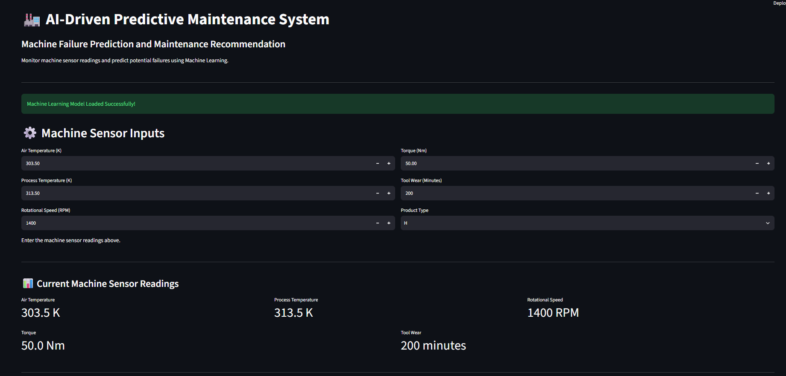

# AI-Driven Predictive Maintenance System Using Machine Learning

## Project Overview

An AI-based predictive maintenance system that predicts potential machine failures using industrial sensor data and machine learning algorithms. The system provides failure probability, explainable AI insights, and maintenance recommendations through an interactive Streamlit dashboard.

## Features

- Machine failure prediction using machine learning.
- Model comparison: Random Forest, Logistic Regression, and XGBoost.
- Explainable AI using SHAP.
- Failure probability estimation.
- Maintenance recommendations.
- Maintenance priority classification (Low, Medium, High).
- Interactive Streamlit dashboard.
- Downloadable maintenance reports in CSV format.

## Technologies Used

- Python
- Pandas and NumPy
- Scikit-learn
- XGBoost
- SHAP
- Matplotlib and Seaborn
- Streamlit

## Dataset

**AI4I 2020 Predictive Maintenance Dataset**

- 10,000 records
- 14 columns
- Sensor readings and machine failure information

Input features include air temperature, process temperature, rotational speed, torque, tool wear, and product type.

Target variable: Machine Failure.

## Machine Learning Models

| Model | Accuracy |
|---|---:|
| Random Forest | 97.95% |
| Logistic Regression | 82.50% |
| XGBoost | 95.70% |

XGBoost was selected for the dashboard because it achieved 86.76% failure recall and 0.7901 PR-AUC.

## Explainable AI

SHAP (SHapley Additive exPlanations) helps explain the influence of sensor features on model predictions.

Important features identified:

1. Torque
2. Tool Wear
3. Rotational Speed
4. Air Temperature
5. Process Temperature

## Project Structure

```text
AI_Predictive_Maintenance/
├── dataset/
├── models/
├── notebooks/
├── reports/
├── app.py
├── requirements.txt
├── README.md
└── .gitignore
```

## Installation and Setup

### 1. Clone the repository

```bash
git clone https://github.com/chaitanyamadire01-dotcom/AI-Predictive-Maintenance-System.git
```

### 2. Open the project folder

```bash
cd AI-Predictive-Maintenance-System
```

### 3. Create a virtual environment

```bash
python -m venv venv
```

### 4. Activate the environment (Windows)

```bash
venv\Scripts\activate
```

### 5. Install dependencies

```bash
pip install -r requirements.txt
```

### 6. Run the application

```bash
streamlit run app.py
```

## Application Features

The dashboard displays:

- Machine failure prediction
- Failure probability
- Maintenance recommendations
- Maintenance priority
- Machine health status
- Model performance metrics
- SHAP visualizations
- Downloadable maintenance reports

## Dashboard Screenshot



## Limitations

This is an academic prototype developed using the AI4I 2020 synthetic dataset. The predictions and maintenance thresholds have not been validated for real industrial machines. The current version does not use live industrial sensors or real-time factory data.

## Author

**Chaitanya Madire**

B.Tech – Artificial Intelligence and Machine Learning

- GitHub: https://github.com/chaitanyamadire01-dotcom
- LinkedIn: https://www.linkedin.com/in/chaitanya-madire-8083493a1/
